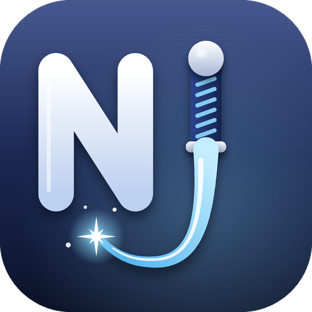
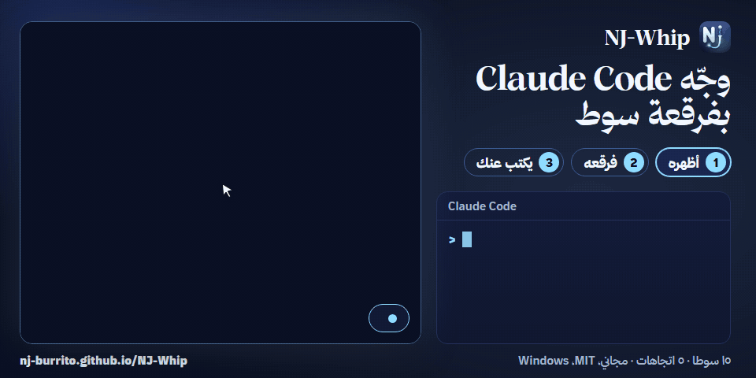
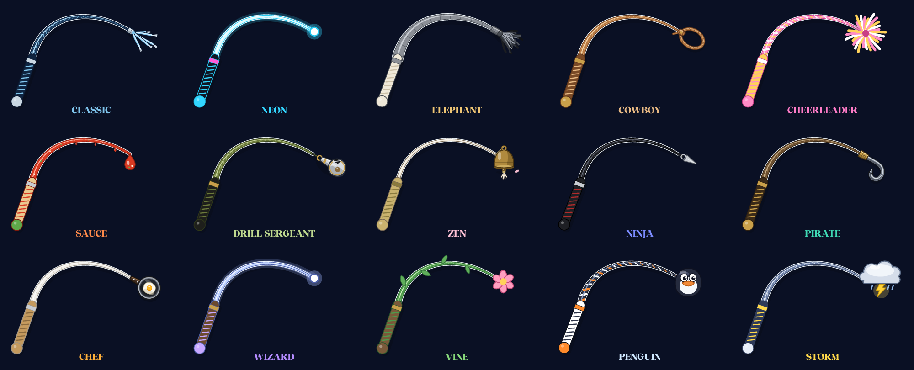
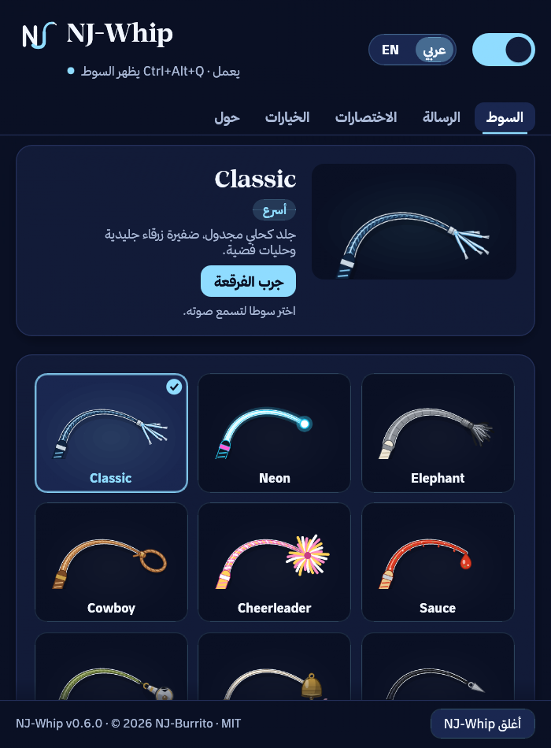
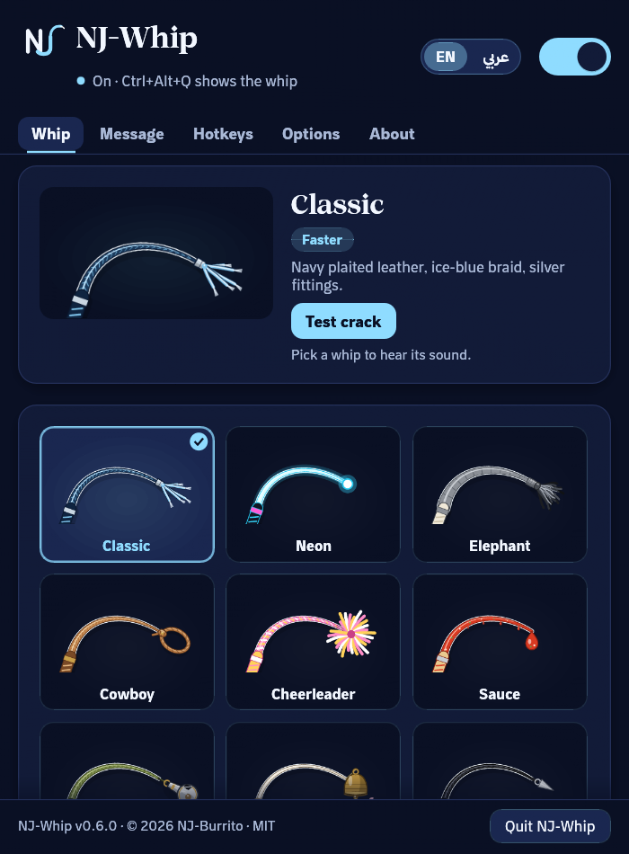

<div dir="rtl">

<p align="center"></p>

<h1 align="center">NJ-Whip</h1>

<h3 align="center">وجه Claude Code بفرقعة سوط.</h3>

<p align="center"><a href="README.md">English</a> · <a href="https://nj-burrito.github.io/NJ-Whip/ar/">الموقع</a> · <a href="https://github.com/NJ-Burrito/NJ-Whip/releases/latest/download/NJ-Whip.exe">التنزيل</a></p>

<p align="center">
  <a href="https://nj-burrito.github.io/NJ-Whip/ar/"></a>
</p>

<p align="center">
  <a href="https://github.com/NJ-Burrito/NJ-Whip/releases/latest"></a>
  <a href="https://github.com/NJ-Burrito/NJ-Whip/actions/workflows/ci.yml"></a>
  <a href="LICENSE"></a>
  
</p>

**NJ-Whip سوط مجاني ومفتوح المصدر لـ Claude Code على Windows، من صنع [نادر الزغول](https://nj-burrito.github.io/) (NJ-Burrito).** لوح به فيفرقع: بصوته الخاص وأثره الخاص، وتكتب لـ Claude تعليمة قصيرة واحدة. ملف exe صغير واحد، بلا برنامج تثبيت وبلا حساب.

🌐 [الموقع](https://nj-burrito.github.io/NJ-Whip/ar/) · 🕹️ [جربه في المتصفح](https://nj-burrito.github.io/NJ-Whip/ar/#room) · ⬇️ [احصل عليه](#get) · ✨ [جديد في 0.6](#new) · 🎯 [ماذا يفعل لعملك](#work) · 🧵 [الأسواط](#whips) · 🪟 [النافذة](#window) · 🪶 [خفيف على حاسوبك](#light) · 🔒 [الخصوصية](#privacy)

---

## ⚡ في عشر ثوان

- 🎯 **ما هو:** سوط على مؤشر الفأرة. كل فرقعة تكتب لـ Claude Code تعليمة قصيرة واحدة.
- 🧭 **لماذا:** لتوجه Claude دون أن تتوقف لتكتب: أسرع، أو أكثر اجتهادا، أو أكثر حذرا، أو أكثر بهجة، أو تركيز.
- 🎉 **وفيه متعة أيضا:** 15 سوطا، لكل سوط صوته وأثره وعلامته في موضع السقوط.
- 💸 **الكلفة:** مجاني برخصة MIT، ملف exe واحد حجمه نحو 8 ميغابايت. بلا برنامج تثبيت وبلا حساب.
- 🔄 **التحديثات:** تبويب «حول»، ثم «ابحث عن تحديث». لا يسأل GitHub إلا حين تضغطه.

<a id="get"></a>

## ⬇️ احصل عليه

1. نزل **[`NJ-Whip.exe`](https://github.com/NJ-Burrito/NJ-Whip/releases/latest/download/NJ-Whip.exe)** (الإصدار 0.6.0، نحو 8 ميغابايت).
2. شغله. تفتح النافذة ويظهر الشعار في منطقة الإشعارات.
3. اقلب المفتاح إلى **تشغيل**.

- 🖥️ **المتطلبات:** Windows 10 (الإصدار 2004 أو أحدث) أو Windows 11.
- 🧹 **الإزالة:** احذف الملف. لا شيء يثبت على جهازك.
- 🛡️ **SmartScreen:** الملف غير موقع رقميا، فقد يسألك Windows قبل التشغيل الأول («مزيد من المعلومات»، ثم «تشغيل على أي حال»). أو [ابنه بنفسك](#build).

<a id="new"></a>

## ✨ جديد في 0.6

الإصدار 0.6.0 يعيد رسم مظهر NJ-Whip. أما ما تكتبه الفرقعة فلم يتغير. [آخر إصدار](https://github.com/NJ-Burrito/NJ-Whip/releases/latest).

- 🎨 **شعار وأيقونة جديدان:** رسم جديد لحرفي N وJ، في منطقة الإشعارات وفي النافذة وفي أيقونة الصفحة.
- 🪢 **أطراف جديدة:** لسوط Classic طرف مفرقع مصقول، ولسوط Cowboy حلقة حبل (لاسو)، ولسوط Drill Sergeant صفارة، ولسوط Zen جرس معبد، ولسوط Pirate خطاف. ومقلاة سوط Chef فيها الآن بيضة، وسوط Elephant ينتهي بخصلة من الجلد.
- 💥 **إعادة رسم المؤثرات الخمسة عشر كلها:** جسيمات وأختام أغنى.
- 🪟 **نافذة إعدادات بتصميم جديد:** بطاقة كبيرة للسوط المختار، وبطاقات لكل مجموعة إعدادات، وأزرار لوحة مفاتيح للاختصارات، وتخطيط عربي يقرأ من اليمين إلى اليسار.
- 🧱 **مصدر أنظف:** قسمت الشيفرة إلى وحدات، ويرسم مصور إطارات خارج الشاشة أي سوط أو مؤثر دون تشغيل الطبقة التي تظهر فوق الشاشة ([`design/renderer.md`](design/renderer.md)).

<a id="work"></a>

## 🎯 ماذا يفعل لعملك

**الفرقعة رسالة قصيرة إلى Claude.** كل سوط يرسل تعليمة حقيقية في واحد من خمسة اتجاهات.

| # | أنت | NJ-Whip |
|---|---|---|
| 1 | اضغط `Ctrl+Alt+Q` | يظهر السوط عند مؤشر الفأرة (اضغط مرة أخرى فيسقط) |
| 2 | اسحبه في اتجاه واخطفه في الاتجاه المعاكس، أو انقر، أو اضغط `Ctrl+Alt+W` | يفرقع: صوت، وأثر، وعلامة في موضع السقوط، وحرارة |
| 3 | تابع عملك | تكتب رسالة واحدة في النافذة التي كنت فيها آخر مرة، ثم `Enter` |

**الاتجاهات الخمسة** (حزمة Plain بصيغتها الخفيفة، كما تكتب حرفيا):

| الاتجاه | ما يكتبه | الإرسال | الأسواط |
|---|---|---|---|
| **أسرع** | "Smallest change that works; no extra files, docs or refactors. When it's done and checked, stop and report." | في قائمة الانتظار، دون `Esc` | Classic، Cowboy، Pirate، Penguin |
| **أكثر اجتهادا** | "Before you say done, run a check that exercises the change and show the output; say what you couldn't run." | في قائمة الانتظار، دون `Esc` | Elephant، Drill Sergeant، Storm |
| **أكثر حذرا** | "Continue, carefully: read each file and its callers before you change it, state the change in two lines, then proceed." | بعد `Esc` | Zen، Chef، Vine |
| **أكثر بهجة** | "Good progress, no rush. If something fails or can't be done, say so plainly with the output, then carry on." | في قائمة الانتظار، دون `Esc` | Cheerleader، Sauce |
| **تركيز** | "Continue only the task I asked for. When it's done and checked, stop and report; list ideas at the end." | بعد `Esc` | Neon، Ninja، Wizard |

- 📨 **في قائمة الانتظار، دون `Esc`:** يقرأ Claude الرسالة في خطوته التالية، ولا يلغى شيء مما يفعله.
- ✋ **بعد `Esc`:** يتوقف Claude قبل خطوته التالية. وتبدأ هذه الرسائل بكلمة "Continue".
- 💬 **الرسالة كاملة:** عبارة السوط المرحة، ثم التعليمة. سوط Classic مع حزمة Plain يكتب: *Crack! Straight line, no detours. Smallest change that works; no extra files, docs or refactors. When it's done and checked, stop and report.*
- 🧪 **للأمانة:** الصياغة تتبع إرشادات منشورة لتوجيه Claude Code، ولم تقس على جلسات حقيقية، فلا نذكر هنا أي رقم عن السرعة.

**ست حزم تعليمات**

| الحزمة | لمن |
|---|---|
| **Plain** (الافتراضية) | أي Claude Code. صيغة **خفيفة** لـ Haiku أو Sonnet بجهد منخفض أو متوسط، وصيغة **ثقيلة** لـ Opus أو Fable بجهد عال. أنت تختار، لأن NJ-Whip لا يرى النموذج الذي تستخدمه |
| **nj-kit** | لمن يستخدم مهارات [NJ-Kit](https://nj-burrito.github.io/NJ-Kit/) |
| **Surgical** | أقل قدر من الكود، وتغييرات صغيرة حذرة |
| **Quiet** | النتيجة أولا، بلا سرد ولا تلخيص |
| **Superpowers** | لمن يستخدم إضافة superpowers |
| **Plan-first** | يوقف Claude ويطلب خطة. كل رسائلها ترسل بعد `Esc` |

- ✍️ **عباراتك أنت:** أضف عبارات لكل سوط، وغير المفاتيح التي ترسلها الفرقعة.
- 🎚️ **مفتاحان، كلاهما مطفأ في البداية:** «اضغط Esc أولا دائما»، و««أشد» تضيف ultrathink» (دورة واحدة بجهد أعلى وتكلفة أكثر).
- 🔄 **«أعد ضبط Claude»:** يكتب `normal mode`، ثم `Continue.`.

<a id="whips"></a>

## 🧵 الأسواط الخمسة عشر

<p align="center"></p>

**لكل سوط شكله ووزنه وصوت فرقعته وأثره وعلامته في موضع السقوط وصيحته.** وتتلاشى العلامة خلال 3 ثوان.

| السوط | يقول لـ Claude | الوزن | العلامة في موضع السقوط | الصيحة |
|---|---|---|---|---|
| **Classic** | أسرع | عادي | ندبة سوط | CRACK |
| **Neon** | تركيز | خفيف | حلقة ضوء | ZAP |
| **Elephant** | أكثر اجتهادا | الأثقل | انبعاج متشقق | STOMP |
| **Cowboy** | أسرع | ثقيل قليلا | حدوة حصان | YEEHAW |
| **Cheerleader** | أكثر بهجة | خفيف | نجمة | RAH |
| **Sauce** | أكثر بهجة | ثقيل | بركة، وأثر يتلاشى خلال 3 ثوان | YUM |
| **Drill Sergeant** | أكثر اجتهادا | ثقيل قليلا | ثقب رصاصة | HUP |
| **Zen** | أكثر حذرا | الأخف | دائرة حبر | OM |
| **Ninja** | تركيز | خفيف | جرح يقطع الشاشة كلها | SLICE |
| **Pirate** | أسرع | ثقيل | علامة X | ARR |
| **Chef** | أكثر حذرا | عادي | بيضة مقلية (وطرفه مقلاة فيها بيضة) | SIZZLE |
| **Wizard** | تركيز | خفيف | رمز سحري | POOF |
| **Vine** | أكثر حذرا | خفيف قليلا | أوراق وزهرة | BLOOM |
| **Penguin** | أسرع | ثقيل قليلا | كومة ثلج | HONK |
| **Storm** | أكثر اجتهادا | ثقيل قليلا | أثر احتراق | BOOM |

- 🪢 **الأطراف:** لسوط Classic طرف مفرقع مصقول، ولسوط Cowboy حلقة حبل (لاسو)، ولسوط Drill Sergeant صفارة، ولسوط Zen جرس معبد، ولسوط Pirate خطاف، ولسوط Chef مقلاة فيها بيضة، ولسوط Elephant خصلة من الجلد.
- 🌀 **التلويحة يجب أن تكون تلويحة حقا.** الحركة الكسولة ذهابا وإيابا تصدر حفيفا فقط. وكل خطفة تفرقع مرة واحدة.
- 🔥 **الحرارة:** مؤشر يمتلئ مع كل فرقعة (4 فرقعات حتى يمتلئ)، ثم تتوهج حواف الشاشة بلون السوط. لا أحمر ولا اهتزاز.
- 🔢 **السلاسل:** فرقع مرة أخرى في الوقت المناسب فتظهر صيحة متتالية ("STOMP ×3").
- 🔊 **الأصوات تستريح:** صوت السوط الخاص ينتظر حتى ينتهي وتمر ثانية واحدة قبل أن يعود.
- 🖼️ **صورتك:** يمكن لأي سوط أن يحمل صورتك طرفا له. وتبقى الصورة على حاسوبك.

<a id="window"></a>

## 🪟 النافذة

<p align="center"> </p>

**نافذة صغيرة واحدة فيها خمسة تبويبات.** كل تغيير يحفظ فورا. ويبقى الرأس والتذييل في مكانهما والمحتوى يتمرر.

| التبويب | ما فيه |
|---|---|
| **السوط** | الأسواط الخمسة عشر، ويظهر المختار على بطاقة كبيرة. واختيار السوط يشغل صوته |
| **الرسالة** | حزمة التعليمات وعباراتك أنت |
| **الاختصارات** | المفاتيح التي تظهر السوط وتفرقعه |
| **الخيارات** | مؤشر الحرارة، والفرقعة بالتلويح، و«ابدأ مع Windows» |
| **حول** | رقم الإصدار وزر **«ابحث عن تحديث»** |

- 🌍 **العربية والإنجليزية:** مفتاح منزلق EN / عربي. الترتيب نفسه، والعربية تقرأ من اليمين إلى اليسار.
- 🔄 **التحديثات:** لا يسأل NJ-Whip موقع GitHub عن آخر إصدار إلا حين تضغط **«ابحث عن تحديث»**، ولا يثبت شيئا إلا بعد أن توافق.
- 🪟 **إغلاق النافذة** يبقي NJ-Whip في منطقة الإشعارات. وزر **«إغلاق»** في النافذة وفي قائمة الأيقونة.

<a id="light"></a>

## 🪶 خفيف على حاسوبك

**صمم ليكون خفيفا، مع مراعاة الحواسيب القديمة والمتواضعة.** ملف exe واحد، والسوط يرسم بالمعالج.

| ما قيس | النتيجة |
|---|---|
| الذاكرة، وهو ساكن في منطقة الإشعارات | نحو 20 ميغابايت (الذاكرة العاملة) |
| المعالج، وهو ساكن في منطقة الإشعارات | نحو 0.5% من نواة واحدة |
| أين قيس | الإصدار 0.3.0، على حاسوب محمول واحد: Intel i5-1334U، وWindows 11 |

- 🧪 **لم يجرب بعد:** على حاسوب قديم.
- 🎨 **يحتاج:** OpenGL لنافذة الإعدادات.

<a id="privacy"></a>

## 🔒 الخصوصية

- 🙅 **لا حساب ولا تتبع.**
- 🌐 **اتصال واحد بالشبكة:** البحث عن تحديث، وحين تضغطه أنت فقط.
- 📁 **الإعدادات:** ملف واحد، `%APPDATA%\NJ-Whip\config.toml`. وتظهر المشكلات في النافذة وفي `errors.txt` و`hotkeys.txt` بجانبه.

## 🚧 حدود معروفة

- ⚠️ **الفرقعة تكتب في النافذة التي كنت فيها آخر مرة**، ولو كانت محرر كود.
- 🧪 **إصدار مبكر:** لم تجرب كل الأماكن التي تكتب فيها لـ Claude باليد بعد (لوحة VS Code، والطرفية، وتطبيق سطح المكتب، وclaude.ai/code).
- 🪟 **لـ Windows فقط.**
- ⌨️ **الاختصارات:** لا يمكن تسجيل اختصار يحجزه NJ-Whip مرة أخرى وهو يعمل.

<a id="build"></a>

## 🛠️ البناء من المصدر

يحتاج Rust (الإصدار المستقر، MSVC) وأدوات Visual Studio C++ Build Tools.

<div dir="ltr">

```
cargo build --release
cargo test --release
```

</div>

- 📦 **الملف التنفيذي:** `target\release\nj-whip.exe`.
- 🔤 **الخطوط:** تستخدم النافذة خطوط ثمانية حين تكون مثبتة، والخط الافتراضي في غير ذلك. لا يأتي أي خط مع هذا المستودع ولا مع الملف التنفيذي.
- 🧱 **توزيع الوحدات:** `src/app` (المحرك)، و`src/whipdraw` (الجلد والمقبض وملف لكل طرف)، و`src/effects` (ملف لكل مؤثر)، و`src/render` (الطبقات والتوهج ومؤشر الحرارة)، و`src/ui` (النافذة).
- 🖼️ **صور دون تشغيل الطبقة الظاهرة:** يكتب التطبيق الحي في نوافذ أخرى، فلا تشغله لترى سوطا. ويكتب مصور الإطارات خارج الشاشة، الموصوف في [`design/renderer.md`](design/renderer.md)، إطارات PNG وورقة معاينة لأي سوط أو مؤثر.
- 🌐 **الأسواط الحية في الموقع:** الأمر `python web/build.py` يبني المحرك نفسه إلى WebAssembly (`docs/assets/nj-whip.wasm`) وينسخ كل صوت يذكره `src/clips.rs`.

## 📜 الرخصة والإسناد

- ⚖️ **الرخصة:** MIT، © 2026 NJ-Burrito ([LICENSE](LICENSE)).
- 🔊 **الأصوات:** تسجيلات برخصة CC0 أو CC BY، ولكل منها إسناده في [CREDITS.md](CREDITS.md).
- 🏷️ **مشروع مستقل:** لا صلة له بشركة Anthropic ولا تتبناه. و"Claude" و"Claude Code" علامتان تجاريتان لـ Anthropic.

## 🧰 أدوات مجانية أخرى من NJ-Burrito

| الأداة | ما تفعله | الروابط |
|---|---|---|
| **QA-Wrap** | إضافة للمتصفح: تسجل جلسة الاختبار وتكتب تقرير الخلل | [الموقع](https://nj-burrito.github.io/QA-Wrap/) · [الكود](https://github.com/NJ-Burrito/QA-Wrap) |
| **NJ-Kit** | طريقة عمل لـ Claude Code: مهارات ينتهي كل منها بسكربت يقول PASS أو FAIL | [الموقع](https://nj-burrito.github.io/NJ-Kit/) · [الكود](https://github.com/NJ-Burrito/NJ-Kit) |
| **Profile-Wrap** | يخطط منشورات LinkedIn ويكتبها ويفحصها | [الموقع](https://nj-burrito.github.io/Profile-Wrap/) · [الكود](https://github.com/NJ-Burrito/Profile-Wrap) |
| **Business-Wrap** | وثائق متطلبات بالعربية والإنجليزية مبنية على الأدلة، تصدر إلى PDF وDOCX | [الموقع](https://nj-burrito.github.io/Business-Wrap/) · [الكود](https://github.com/NJ-Burrito/Business-Wrap) |

</div>
| **NJ-Flush** | منظف مجاني لذاكرة Windows | [الموقع](https://nj-burrito.github.io/NJ-Flush/) · [الكود](https://github.com/NJ-Burrito/NJ-Flush) |
| **NJ-Sort** | يبقي أيقونات سطح مكتب Windows حيث وضعتها، حتى بعد إعادة تشغيل مستكشف الملفات | [الموقع](https://nj-burrito.github.io/NJ-Sort/) · [الكود](https://github.com/NJ-Burrito/NJ-Sort) |
| **Story-Wrap** | أدوات لـ Claude Code تصنع مقاطع قصص عربية متحركة | [الموقع](https://nj-burrito.github.io/story-wrap/) · [الكود](https://github.com/NJ-Burrito/Story-Wrap) |
| **الموقع الشخصي** | نادر الزغول، مهندس أتمتة ضمان الجودة في عمان، الأردن | [الموقع](https://nj-burrito.github.io/ar/) |
