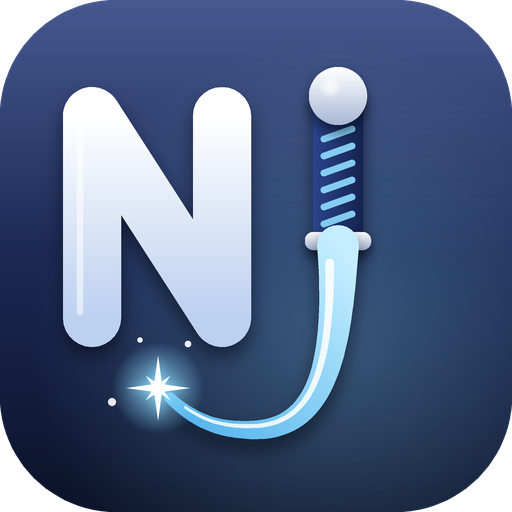
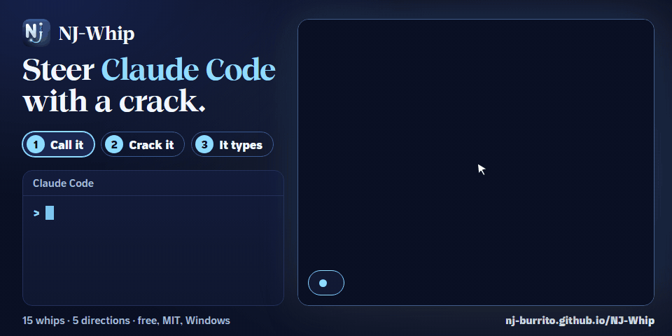
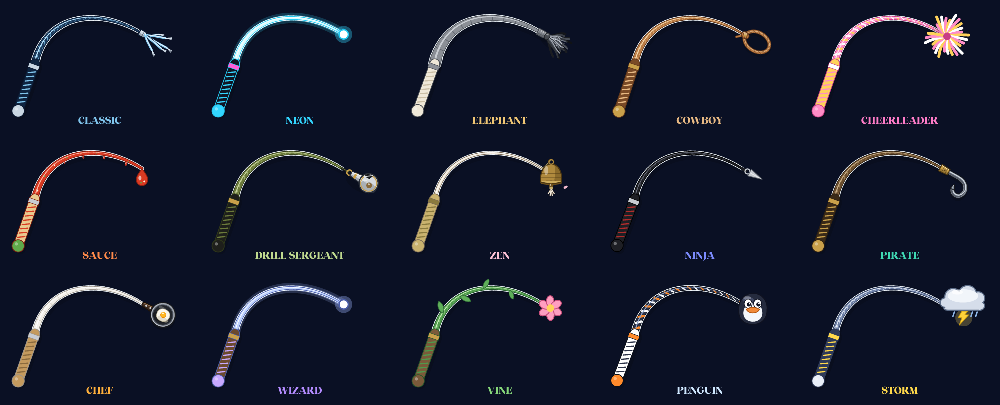
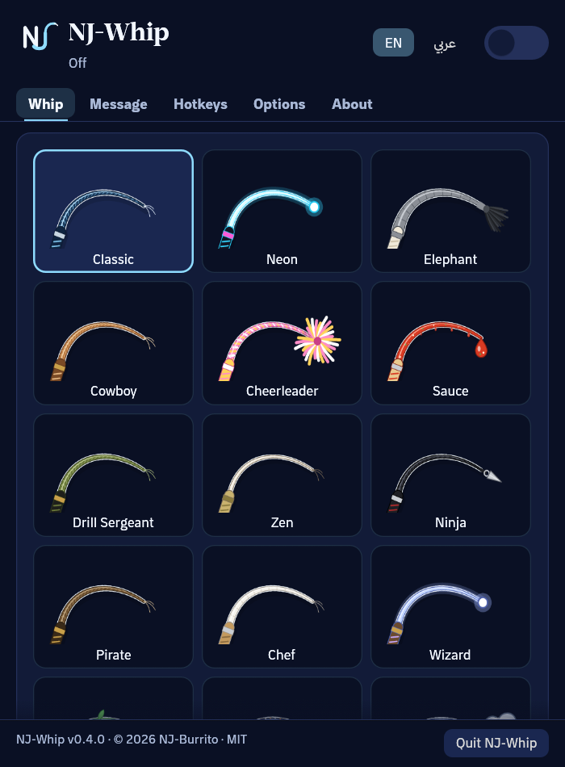
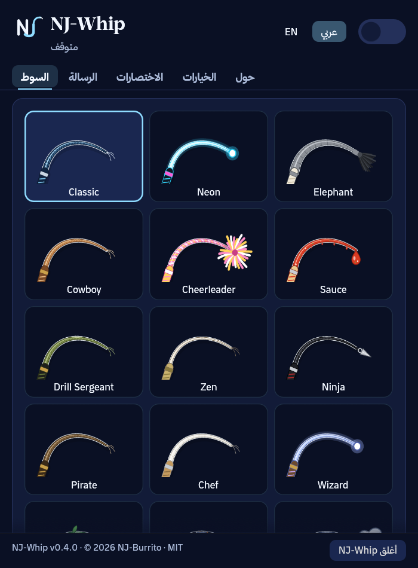

<p align="center"></p>

<h1 align="center">NJ-Whip</h1>

<h3 align="center">Steer Claude Code with a crack of the whip.</h3>

<p align="center"><a href="README.ar.md">العربية</a> · <a href="https://nj-burrito.github.io/NJ-Whip/">Website</a> · <a href="https://github.com/NJ-Burrito/NJ-Whip/releases/latest/download/NJ-Whip.exe">Download</a></p>

<p align="center">
  <a href="https://nj-burrito.github.io/NJ-Whip/"></a>
</p>

<p align="center">
  <a href="https://github.com/NJ-Burrito/NJ-Whip/releases/latest"></a>
  <a href="https://github.com/NJ-Burrito/NJ-Whip/actions/workflows/ci.yml"></a>
  <a href="LICENSE"></a>
  
  <a href="README.ar.md"></a>
</p>

**NJ-Whip is a free, open-source whip for Claude Code on Windows, made by [Nader Alzghoul](https://nj-burrito.github.io/) (NJ-Burrito).** Swing it and it cracks: its own sound, its own effect, and one short instruction typed to Claude. One small exe, no installer, no account.

🌐 [Website](https://nj-burrito.github.io/NJ-Whip/) · 🕹️ [Try it in the browser](https://nj-burrito.github.io/NJ-Whip/#room) · ⬇️ [Get it](#get) · 🎯 [What it does for your work](#work) · 🧵 [The whips](#whips) · 🪟 [The window](#window) · 🪶 [Light on your PC](#light) · 🔒 [Privacy](#privacy)

---

## ⚡ In 10 seconds

- 🎯 **What:** a whip on your mouse. A crack types one short instruction to Claude Code.
- 🧭 **Why:** to steer Claude without stopping to write: faster, harder, careful, happier or focus.
- 🎉 **Fun too:** 15 whips, each with its own sound, effect and landing mark.
- 💸 **Cost:** free, MIT, one exe of about 6.7 MB. No installer, no account.
- 🔄 **Updates:** About tab, **Check for updates**. It asks GitHub only when you press it.

<a id="get"></a>

## ⬇️ Get it

1. Download **[`NJ-Whip.exe`](https://github.com/NJ-Burrito/NJ-Whip/releases/latest/download/NJ-Whip.exe)** (version 0.4.0, about 6.7 MB).
2. Run it. The window opens and the monogram appears in the tray.
3. Flip the switch to **On**.

- 🖥️ **Needs:** Windows 10 (2004 or later) or Windows 11.
- 🧹 **Remove:** delete the exe. Nothing is installed.
- 🛡️ **SmartScreen:** the exe is not code-signed, so Windows may ask before the first run ("More info", then "Run anyway"). Or [build it yourself](#build).

<a id="work"></a>

## 🎯 What it does for your work

**A crack is a short message to Claude.** Each whip sends a real instruction in one of five directions.

| # | You | NJ-Whip |
|---|---|---|
| 1 | Press `Ctrl+Alt+Q` | The whip is on your mouse (press again and it drops away) |
| 2 | Wind up one way and snap back, or click, or press `Ctrl+Alt+W` | It cracks: sound, effect, landing mark, heat |
| 3 | Keep working | One message is typed into the window you were in last, then `Enter` |

**The five directions** (Plain pack, Light wording, as typed):

| Direction | It types | Sent | Whips |
|---|---|---|---|
| **Faster** | "Smallest change that works; no extra files, docs or refactors. When it's done and checked, stop and report." | Queued, no `Esc` | Classic, Cowboy, Pirate, Penguin |
| **Harder** | "Before you say done, run a check that exercises the change and show the output; say what you couldn't run." | Queued, no `Esc` | Elephant, Drill Sergeant, Storm |
| **Careful** | "Continue, carefully: read each file and its callers before you change it, state the change in two lines, then proceed." | After `Esc` | Zen, Chef, Vine |
| **Happier** | "Good progress, no rush. If something fails or can't be done, say so plainly with the output, then carry on." | Queued, no `Esc` | Cheerleader, Sauce |
| **Focus** | "Continue only the task I asked for. When it's done and checked, stop and report; list ideas at the end." | After `Esc` | Neon, Ninja, Wizard |

- 📨 **Queued, no `Esc`:** Claude reads the line at its next step. Nothing it is doing is cancelled.
- ✋ **After `Esc`:** Claude stops before its next step. These lines begin with "Continue".
- 💬 **The whole message:** the whip's fun line, then the instruction. Classic with Plain types: *Crack! Straight line, no detours. Smallest change that works; no extra files, docs or refactors. When it's done and checked, stop and report.*
- 🧪 **Honest note:** the wording follows published guidance on steering Claude Code. It has not been measured on live sessions, so there is no speed figure here.

**Six instruction packs**

| Pack | For |
|---|---|
| **Plain** (default) | Any Claude Code. **Light** wording for Haiku or Sonnet at low or medium effort, **Heavy** for Opus or Fable at high effort. You pick: NJ-Whip cannot see your model |
| **nj-kit** | People who use the [NJ-Kit](https://nj-burrito.github.io/NJ-Kit/) skills |
| **Surgical** | Minimum code, small careful changes |
| **Quiet** | Result first, no narration or recap |
| **Superpowers** | People who use the superpowers plugin |
| **Plan-first** | Pauses Claude and asks for a plan. Every line is sent after `Esc` |

- ✍️ **Your own lines:** add lines per whip, and change the keys a crack sends.
- 🎚️ **Two switches, both off at first:** *Always press Esc first*, and *HARDER adds ultrathink* (that turn costs more).
- 🔄 **Reset Claude:** types `normal mode`, then `Continue.`.

<a id="whips"></a>

## 🧵 The 15 whips

<p align="center"></p>

**Each whip has its own look, weight, crack sound, effect, landing mark and shout.** The mark fades in 3 seconds.

| Whip | Tells Claude | Weight | Landing mark | Shout |
|---|---|---|---|---|
| **Classic** | Faster | normal | a lash scar | CRACK |
| **Neon** | Focus | light | a ring of light | ZAP |
| **Elephant** | Harder | heaviest | a cracked dent | STOMP |
| **Cowboy** | Faster | a little heavy | a horseshoe | YEEHAW |
| **Cheerleader** | Happier | light | a star | RAH |
| **Sauce** | Happier | heavy | a puddle, plus a trail that fades in 3 s | YUM |
| **Drill Sergeant** | Harder | a little heavy | a bullet hole | HUP |
| **Zen** | Careful | lightest | an ink circle | OM |
| **Ninja** | Focus | light | a cut across the whole screen | SLICE |
| **Pirate** | Faster | heavy | an X | ARR |
| **Chef** | Careful | normal | a fried egg (the tip is a frying pan) | SIZZLE |
| **Wizard** | Focus | light | a rune | POOF |
| **Vine** | Careful | a little light | leaves and a flower | BLOOM |
| **Penguin** | Faster | a little heavy | a snow pile | HONK |
| **Storm** | Harder | a little heavy | a scorch | BOOM |

- 🌀 **A swing has to be a swing.** A lazy back-and-forth only whooshes. Each snap cracks once.
- 🔥 **Heat:** a meter fills with each crack (4 to full), then the screen edges glow in the whip's colour. Never red, no shake.
- 🔢 **Streaks:** crack again in time and a combo label pops up ("STOMP ×3").
- 🔊 **Voices rest:** a whip's own voice clip waits until it has ended plus 1 second before it plays again.
- 🖼️ **Your picture:** any whip can carry your own picture as its tip. It stays on your computer.

<a id="window"></a>

## 🪟 The window

<p align="center"> </p>

**One small window with five tabs.** Everything is saved as you change it. The header and footer stay put while the content scrolls.

| Tab | What is in it |
|---|---|
| **Whip** | The 15 whips. Picking one plays its sound |
| **Message** | The instruction pack and your own lines |
| **Hotkeys** | The keys that call the whip and crack it |
| **Options** | The heat meter, the swing crack, Start with Windows |
| **About** | The version and **Check for updates** |

- 🌍 **English and Arabic:** a sliding EN / عربي switch. Same layout; the Arabic reads right to left.
- 🔄 **Updates:** NJ-Whip asks GitHub for the latest release only when you press **Check for updates**, and installs only when you confirm.
- 🪟 **Closing the window** keeps NJ-Whip in the tray. **Quit** is in the window and in the tray menu.

<a id="light"></a>

## 🪶 Light on your PC

**Built to be light, with older and low-spec PCs in mind.** One exe; the whip is drawn on the CPU.

| Measured | Result |
|---|---|
| Memory, resting in the tray | about 20 MB (working set) |
| CPU, resting in the tray | about 0.5% of one core |
| Where | version 0.3.0, one laptop: Intel i5-1334U, Windows 11 |

- 🧪 **Not tested yet:** an older PC.
- 🎨 **Needs:** OpenGL for the settings window.

<a id="privacy"></a>

## 🔒 Privacy

- 🙅 **No account, no telemetry.**
- 🌐 **One network call:** the update check, and only when you press it.
- 📁 **Settings:** one file, `%APPDATA%\NJ-Whip\config.toml`. Problems show in the window and in `errors.txt` and `hotkeys.txt` beside it.

## 🚧 Known limits

- ⚠️ **A crack types into the window you were in last**, a code editor included.
- 🧪 **Early release:** not every place you type to Claude (VS Code panel, terminal, desktop app, claude.ai/code) has been hand-tested yet.
- 🪟 **Windows only.**
- ⌨️ **Hotkeys:** a hotkey NJ-Whip holds cannot be recorded again while it runs.

<a id="build"></a>

## 🛠️ Build from source

Needs Rust (stable, MSVC) and the Visual Studio C++ Build Tools.

```
cargo build --release
cargo test --release
```

- 📦 **The exe:** `target\release\nj-whip.exe`.
- 🔤 **Fonts:** the window uses the Thmanyah typefaces when they are installed, and the default font otherwise. No font ships in this repository or in the exe.
- 🌐 **The website's live whips:** `python web/build.py` builds the same engine to WebAssembly (`docs/assets/nj-whip.wasm`) and copies every sound `src/clips.rs` names.

## 📜 Licence and credits

- ⚖️ **Licence:** MIT, © 2026 NJ-Burrito ([LICENSE](LICENSE)).
- 🔊 **Sounds:** CC0 or CC BY recordings, each credited in [CREDITS.md](CREDITS.md).
- 🏷️ **Independent:** not affiliated with or endorsed by Anthropic. "Claude" and "Claude Code" are trademarks of Anthropic.

## 🧰 More free tools by NJ-Burrito

| Tool | What it does | Links |
|---|---|---|
| **QA-Wrap** | Browser extension: records a test session and writes the bug report | [Site](https://nj-burrito.github.io/QA-Wrap/) · [Code](https://github.com/NJ-Burrito/QA-Wrap) |
| **NJ-Kit** | A working method for Claude Code: skills that each end in a script saying PASS or FAIL | [Site](https://nj-burrito.github.io/NJ-Kit/) · [Code](https://github.com/NJ-Burrito/NJ-Kit) |
| **Profile-Wrap** | Plans, writes and checks LinkedIn posts | [Site](https://nj-burrito.github.io/Profile-Wrap/) · [Code](https://github.com/NJ-Burrito/Profile-Wrap) |
| **Business-Wrap** | Arabic and English requirements documents from evidence, exported to PDF and DOCX | [Site](https://nj-burrito.github.io/Business-Wrap/) · [Code](https://github.com/NJ-Burrito/Business-Wrap) |
