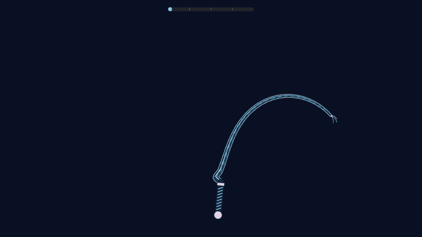

<p align="center"></p>

<h1 align="center">NJ-Whip</h1>

<h3 align="center">An on-screen whip for Claude Code. Swing it, it cracks, and Claude gets the message.</h3>

<p align="center">
  <a href="https://nj-burrito.github.io/NJ-Whip/"></a>
</p>

<p align="center">
  <a href="https://nj-burrito.github.io/NJ-Whip/"></a>
  <a href="https://github.com/NJ-Burrito/NJ-Whip/releases/latest"></a>
  <a href="https://github.com/NJ-Burrito/NJ-Whip/actions/workflows/ci.yml"></a>
  <a href="LICENSE"></a>
  
  
  <a href="https://github.com/NJ-Burrito/NJ-Whip/stargazers"></a>
</p>

**NJ-Whip is a free, open-source whip for Claude Code on Windows, made by [Nader Alzghoul](https://nj-burrito.github.io/) (NJ-Burrito).** Put it on your mouse, swing it, and it cracks: its own sound, its own effect, and one short message typed to Claude that says *faster*, *harder*, *careful*, *happier* or *focus*. One small exe, no installer, no account.

🌐 [Website](https://nj-burrito.github.io/NJ-Whip/) · [بالعربية](https://nj-burrito.github.io/NJ-Whip/ar/) · ⬇️ [Download](https://github.com/NJ-Burrito/NJ-Whip/releases/latest) · 🧵 [The whips](#whips) · 💬 [Messages](#messages) · 🔒 [Privacy](#privacy) · 🛠️ [Build](#build)

---

## ⬇️ Get it

1. Download **`NJ-Whip.exe`** from the [latest release](https://github.com/NJ-Burrito/NJ-Whip/releases/latest) (about 6.5 MB).
2. Run it. The NJ-Whip window opens and the monogram appears in the tray.
3. Flip the switch to **On**.

Needs Windows 10 (2004 or later) or Windows 11. Nothing is installed: delete the exe and it is gone.

> 🛡️ The exe is not code-signed, so Windows SmartScreen may ask before the first run ("More info", then "Run anyway"). The source is all here if you would rather [build it yourself](#build).

## 🪄 How it works

| | You | NJ-Whip |
|---|---|---|
| 1 | Press `Ctrl+Alt+Q` | The whip is on your mouse (press again and it drops away) |
| 2 | Wind up one way and snap back the other, or click, or press `Ctrl+Alt+W` | It cracks: sound, effect, heat |
| 3 | Keep working | One short message is typed into the window you were in last, then `Enter` |

- 🌀 **A swing has to be a swing.** A lazy back-and-forth only whooshes. Each snap cracks once, so a streak goes right, left, right.
- 🏋️ **Every whip has a weight.** A heavy one (Elephant, Pirate, Sauce) trails your hand and wants a fuller swing. A light one (Zen, Ninja, Cheerleader) answers at once.
- 🪟 **Closing the window keeps NJ-Whip in the tray.** Click the tray icon to open it again. **Quit** is in the window and in the tray menu.

> ⚠️ **Careful:** a crack types into whatever window you were in last, a code editor included. NJ-Whip is made for Claude Code wherever you type to it: the VS Code panel, a terminal, the Claude desktop app, claude.ai/code. Version 0.3.0 is an early release, and not every one of these places has been hand-tested yet.

<a id="whips"></a>

## 🧵 The 15 whips

<p align="center"></p>

Each whip pushes Claude one way and has its own look, tip, weight, crack effect, lines and combo shout.

| Whip | Tells Claude | Feel | Shout | Look |
|---|---|---|---|---|
| **Classic** | Faster | normal | CRACK | Navy plaited leather, ice-blue braid, silver fittings |
| **Neon** | Focus | light | ZAP | Glowing tube with a clean light bead |
| **Elephant** | Harder | heaviest | STOMP | Heavy grey hide with a tufted tail tip |
| **Cowboy** | Faster | a little heavy | YEEHAW | Tan rawhide braid, brass knob, a lasso swirl |
| **Cheerleader** | Happier | light | RAH | Pink-and-gold ribbon, pom-pom tip, confetti |
| **Sauce** | Happier | heavy | YUM | Glossy salsa with a hanging drop |
| **Drill Sergeant** | Harder | a little heavy | HUP | Olive webbing, brass buckle, a stern "!" |
| **Zen** | Careful | lightest | OM | Silk thread on bamboo, an ink ripple and a petal |
| **Ninja** | Focus | light | SLICE | Black cord, steel kunai tip, a clean slash |
| **Pirate** | Faster | heavy | ARR | Tarred hemp, cutlass hilt, sea spray |
| **Chef** | Careful | normal | SIZZLE | Kitchen-towel lash, wooden spoon, steam |
| **Wizard** | Focus | light | POOF | A ribbon of starlight with a crystal bead |
| **Vine** | Careful | a little light | BLOOM | A living vine whose bud blooms on a crack |
| **Penguin** | Faster | a little heavy | HONK | A clay penguin rides the tip |
| **Storm** | Harder | a little heavy | BOOM | A thundercloud tip and lightning |

🖼️ Any whip can carry **your own picture** as its tip. The background is removed for you and the picture stays on your computer.

## 🔥 Heat and streaks

- **Heat meter.** A bar at the top fills with each crack (4 to full) and drains smoothly about a second after the last one.
- **Full heat.** The bar turns bright and the screen edges glow softly in the whip's own colour and style: breathing, a flicker, a sway, a jolt per crack, rising from the bottom, falling from the top, or side to side. Never red, and the screen never shakes.
- **Streaks.** Crack again in time and a combo label pops up in the whip's colour ("STOMP ×3"), then fades.

<a id="messages"></a>

## 💬 What a crack types

One message: **the whip's fun line + a real instruction**, then `Enter`. For example, the Classic whip with the Plain pack types:

> Crack! Straight line, no detours. Smallest change that works; no extra files, docs or refactors. When it's done and checked, stop and report.

**How it is sent** depends on the direction:

| Direction | Sent | Why |
|---|---|---|
| Faster, Harder, Happier | Queued: text and `Enter`, no `Esc` | Claude reads it at its next step and nothing it is doing is cancelled |
| Careful, Focus | After `Esc` | Claude stops before its next step. These lines begin with "Continue" |

**Six instruction packs**

| Pack | For |
|---|---|
| **Plain** (default) | Any Claude Code. Two wordings: **Light** for Haiku or Sonnet at low or medium effort, **Heavy** for Opus or Fable at high effort. NJ-Whip cannot see your model, so you pick |
| **nj-kit** | People who use the [NJ-Kit](https://nj-burrito.github.io/NJ-Kit/) skills |
| **Surgical** | Minimum code, small careful changes |
| **Quiet** | Result first, no narration or recap |
| **Superpowers** | People who use the superpowers plugin |
| **Plan-first** | Pauses Claude and asks for a plan. Every line of this pack is sent after `Esc` |

- ✍️ **Your own lines.** Add lines per whip, and change the keys a crack sends (Options, "Keys a crack sends").
- 🎚️ **Two switches**, both off at first: *Always press Esc first* (use it if queued messages get lost) and *HARDER adds ultrathink* (that one turn runs at extra-high effort and costs more).
- 🔄 **Reset Claude** types two messages: `normal mode`, then `Continue.`. The first ends a sticky mode, the second sends Claude back to work.

> 🧪 The wording follows published guidance on steering Claude Code. It has not been measured on live sessions.

## ⚙️ The window

<p align="center"></p>

Everything is saved as you change it. Two themes, Polar Night and Glacier, or follow Windows.

<a id="privacy"></a>

## 🔒 Privacy

- No account, no network calls, no telemetry.
- Settings live in `%APPDATA%\NJ-Whip\config.toml`. Problems (a hotkey another app already holds, keystrokes Windows refused) show in the window and in `errors.txt` and `hotkeys.txt` in the same folder.
- If `config.toml` cannot be read, NJ-Whip keeps your last settings and saves a copy of the file as `config.broken.toml` instead of overwriting it.

## 🚧 Known limits

- Windows only.
- Arabic text in the window is shown unjoined (it is still typed correctly).
- A hotkey NJ-Whip has registered cannot be recorded again while it runs, and recording the active crack hotkey fires a real crack.
- Only the Vine whip has a crack sound of its own so far. The others share five leather cracks, plus their own voice or effect clip where one exists.

<a id="build"></a>

## 🛠️ Build from source

Needs Rust (stable, MSVC) and the Visual Studio C++ Build Tools.

```
cargo build --release
cargo test --release
```

The exe is `target\release\nj-whip.exe`. The window and the combo label use the Thmanyah typefaces when they are installed on your computer, and the default font otherwise. No font is shipped in this repository or in the exe.

## 📜 Licence and credits

MIT, © 2026 NJ-Burrito (see [LICENSE](LICENSE)). Sounds are CC0 or CC BY, each credited in [CREDITS.md](CREDITS.md).

NJ-Whip is an independent project. It is not affiliated with or endorsed by Anthropic; "Claude" and "Claude Code" are trademarks of Anthropic.

## 🧰 More free tools by NJ-Burrito

| Tool | What it does | |
|---|---|---|
| **QA-Wrap** | Browser extension: records a test session, links every failure to the action behind it, writes the bug report | [Site](https://nj-burrito.github.io/QA-Wrap/) · [Code](https://github.com/NJ-Burrito/QA-Wrap) |
| **NJ-Kit** | A working method for Claude Code: skills that each end in a script saying PASS or FAIL | [Site](https://nj-burrito.github.io/NJ-Kit/) · [Code](https://github.com/NJ-Burrito/NJ-Kit) |
| **Profile-Wrap** | Plans, writes and checks LinkedIn posts | [Site](https://nj-burrito.github.io/Profile-Wrap/) · [Code](https://github.com/NJ-Burrito/Profile-Wrap) |
| **Business-Wrap** | Arabic and English requirements documents from evidence, exported to PDF and DOCX | [Site](https://nj-burrito.github.io/Business-Wrap/) · [Code](https://github.com/NJ-Burrito/Business-Wrap) |
